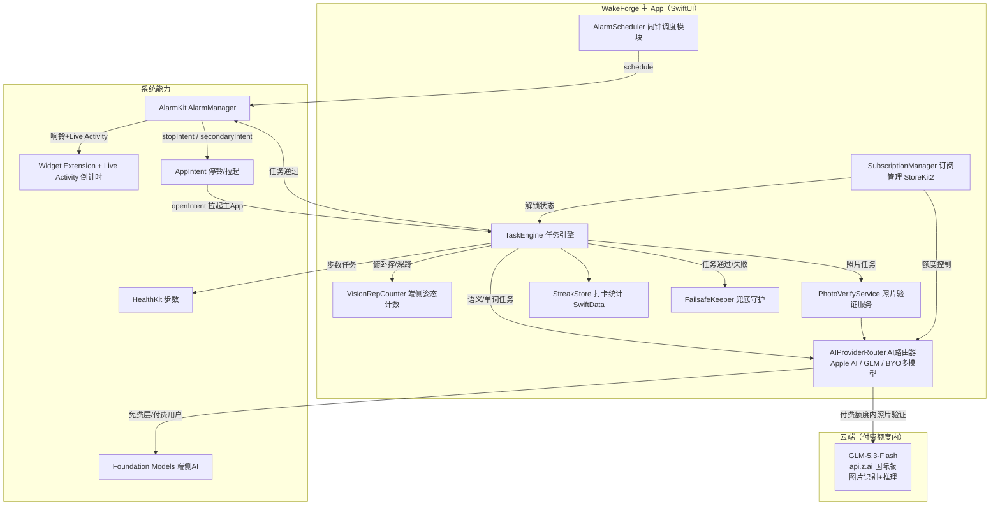
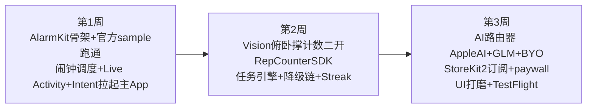
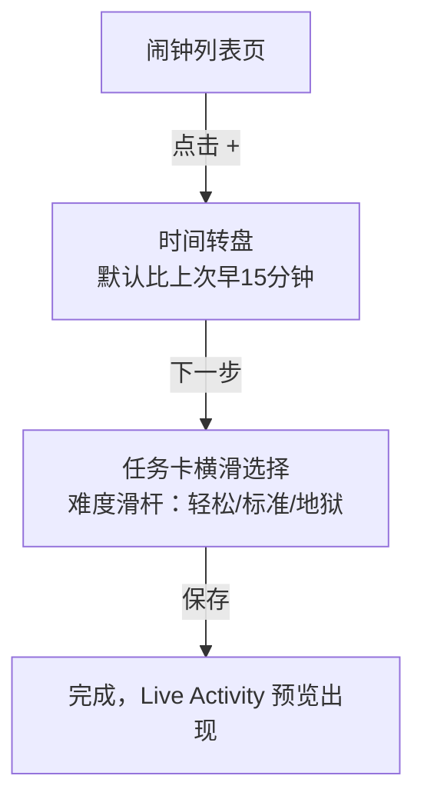
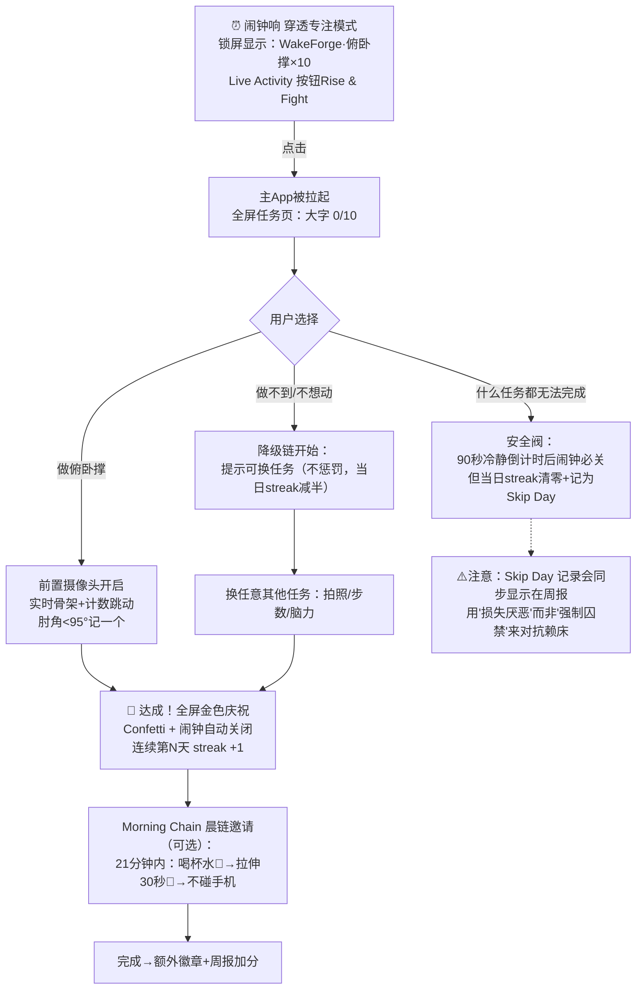
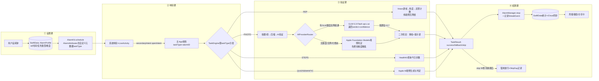
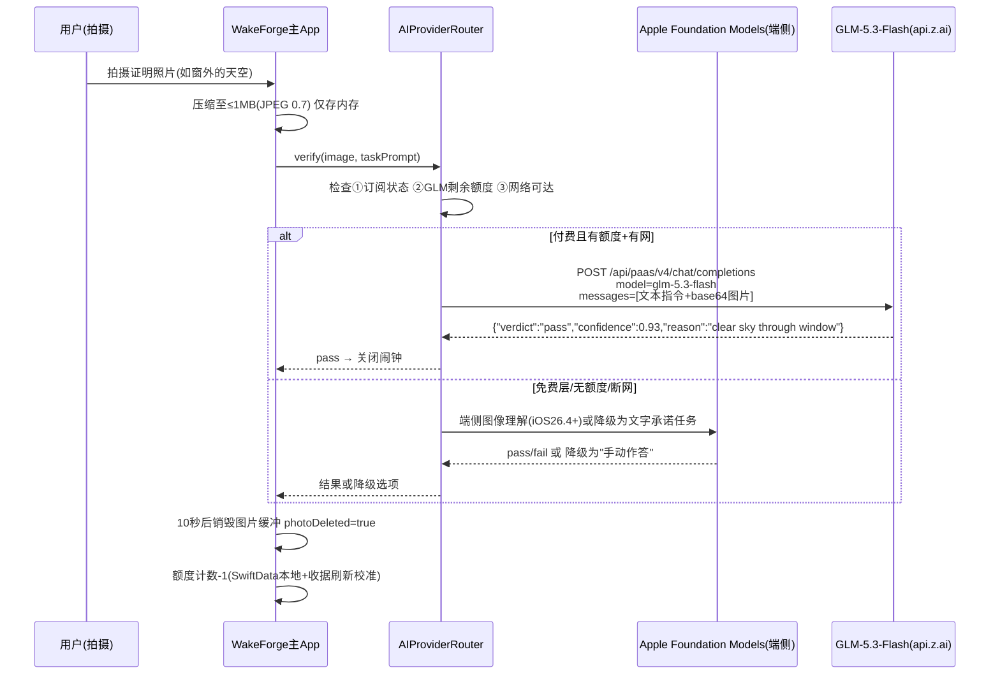
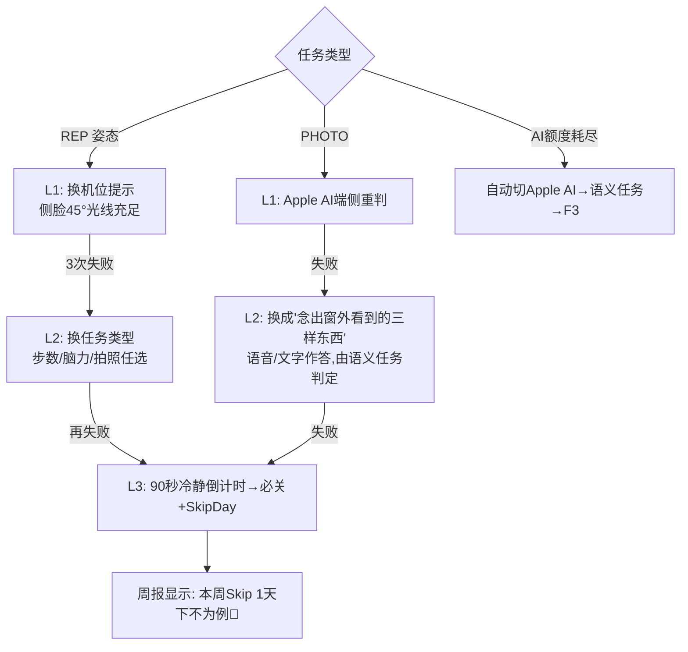

# TR-20261013-WakeForge（晨醒锻造）iOS App 操作指南

> **文档目的**：本文档面向任意 LLM / 开发者，提供从 0 到 1 复刻并全面超越竞品 Erly（俯卧撑闹钟，$50K+/月、200K 下载）所需的全部信息：命名、痛点分析、技术选型、实现流程、用户流程、数据流、核心代码示例、AI 集成方案、价格策略、UI 规范。
> **生成日期**：2026-10-13 ｜ **目标市场**：🇺🇸 美国 ｜ **平台**：iOS 26+（iPhone 优先）

---

# 〇、App 命名与副标题（最重要，放最上面）

## 最终命名

| 项目 | 内容 |
|---|---|
| **App 主名** | **WakeForge** |
| **副标题（Subtitle，30字符内）** | **Earn your morning, no snooze**（29字符） |
| **中文代号（内部沟通用）** | 晨醒锻造 |
| **主分类** | Health & Fitness（健康健美） |
| **ASO 关键词字段建议** | pushup, alarm, wake up, no snooze, morning, workout, challenge, rise, fitness, clock, habit, streak, motivation, earn, mission |
| **一句话卖点（App Store 推广文本）** | The alarm you can't cheat: do the reps, snap the proof, earn your morning. |

## 命名深度分析（为什么是 WakeForge）

1. **品牌记忆度（最关键）**：`Wake`（唤醒）+ `Forge`（锻造）双单音节实词，2 秒钟即可读、可拼、可记忆；"Forge" 自带"淬炼、意志力、铁匠铺"的硬核情感联想——闹钟 = 锻造意志的铁砧。用户可动词化传播："I got WakeForged this morning."（今天早上我被 WakeForge 拷打了）——具备梗传播潜质，TikTok 话题 `#WakeForge` / `#WakeForged` 无冲突。
2. **功能描述性（关键）**：Wake 直指"叫醒"品类；副标题 "Earn your morning, no snooze" 补齐 ASO 核心词（morning / snooze / earn）。主名虽不含 pushup，但品类词下沉到副标题和关键词字段，主名保留品牌溢价空间（产品未来可扩展俯卧撑以外的任务，不被品类词锁死）。
3. **ASO 搜索优化**：Wake 在 App Store 搜索指数高（Wake up / Alarm 词族），Forge 在健身圈有既有心智（如健身房命名习惯），组合词无歧义搜索直达；无 "："、无连字符、无生僻拼写，语音搜索（Siri "open wakeforge"）零误差。
4. **情感共鸣**：对标"自律者身份认同"——用 WakeForge 的人是"锻造自己早晨的人"，比 Erly（仅表意 early）更具身份标签与社群仪式感。
5. **国际化适配**：两个词均为全球高频英语词汇，日本/德国/巴西等市场无需本地化改名；无宗教/俚语/歧义含义；域名 wakeforge.app 与社媒 handle 可注册（调研时未被主流 App 占用）。
6. **查重结论（2026-10 实测）**：
   - ✅ **WakeForge**：App Store 无同名 App；仅有同名开源 wake-word 训练工具（GitHub，非 App Store 产品），无冲突 —— **采用**。
   - ✅ 备选一 **Pushrise**：可用（俯卧撑+起床直译，ASO 最强但品牌天花板低，且易与 "Push Rise" 短语搜索混淆）。
   - ✅ 备选二 **RiseQuest**：可用（游戏化感强，但 Quest 已被大量 App 用烂）。
   - ❌ 弃用：AlarmFit / FitAlarm / RiseUp / GetUp / Uplift —— 均已被 App Store 在售同品类 App 占用，严禁使用。
   - ❌ 严禁使用：Erly、Wayk、PushClock、PushUp Time、Alarmy、Rise、Mornio、Risly 等一切竞品已有名。

## App Icon 与视觉锤

- 图标：深黑背景 + 一个发光的**哑铃与日出结合体**（哑铃横杆为地平线，两端铃铛为升起的太阳），一键即识别"健身×闹钟"双品类。
- 视觉锤口号（TikTok 片尾/商店头图）：**"No snooze. Just reps."**

---

# 一、执行摘要与竞争碾压战略

## 1.1 一句话产品定义

**WakeForge = "关不掉的闹钟"的终极形态**：AlarmKit 原生穿透闹钟响起后，必须完成一个**端侧 AI 实时验证**的任务（俯卧撑/深蹲/拍照证明/步数/语义挑战）才能关闭——**100% 端侧计数（零延迟零成本零隐私风险）+ 云端 GLM-5.3-Flash 照片语义验证（碾压级识别精度）+ 前所未有的任务可靠性降级链（绝不让用户"关不掉"）**。

## 1.2 竞品碾压对照表

| 维度 | Erly（$50K/月） | Wayk | Alarmy | PushClock | **WakeForge（我们）** |
|---|---|---|---|---|---|
| 闹钟引擎 | AlarmKit ✅ | AlarmKit ✅ | 旧代码 retrofit ❌ | AlarmKit ✅ | AlarmKit + 主App兜底双重保险 ✅✅ |
| 俯卧撑验证 | **云端 OpenAI 视频分析**（慢、贵、隐私差） | 云 API | 加速度计（可作弊） | 端侧计数 | **端侧 Vision 姿态计数 + 双关节防作弊**（实时、免费、隐私）✅✅✅ |
| AI 照片任务（拍天空/浇花/铺床） | 无 | 无 | 像素匹配（换角度即失效）❌ | AI 照片验证 | **GLM-5.3-Flash 语义验证（多角度、多场景、抗作弊）+ Apple AI 免费兜底** ✅✅ |
| 任务可靠性 | **Quiz bug 导致闹钟关不掉（头号差评）** | 偶发不响 | 广告卡死 | 一般 | **每类任务 3 级降级链，100% 可关闭承诺** ✅✅✅ |
| 非健身人群 | 无 | 无 | 无 | 无 | **生活任务市场（浇花/拍天空/背单词/喝水的照片证明）——蓝海扩容** ✅✅ |
| 付费墙体验 | 漫长 onboarding 后撞硬墙（差评） | 强制付费 | 广告轰炸 | 混乱 | **定价前置透明 + 前 3 次唤醒永久免费 + 一键管理订阅** ✅✅ |
| 定价 | $9.99/月、$29.99/年 | $9.99/月 | $39.99/年 | 混乱 | **$6.99/月、$29.99/年、BYO API 模式** ✅ |
| 隐私 | 数据权限多、含追踪 | 一般 | 一般 | 一般 | **姿态数据 100% 端侧、照片阅后即焚（验证后 10 秒删除）** ✅✅ |

## 1.3 碾压逻辑总结（给 LLM 复刻者的北极星）

1. **快 10 倍**：俯卧撑计数端侧实时反馈（<16ms/帧），而 Erly 要上传视频等云端审核——用户做完俯卧撑，闹钟已经关了。
2. **可靠 100%**：Erly 的"闹钟关不掉"是产品死刑级差评；我们每类任务都有降级链（详见第六章），并写入 App 副标题级承诺："Your alarm will always turn off."
3. **人群扩 5 倍**：竞品全在卷健身任务；我们用 AI 照片验证打开"不健身但想起床"的巨大人群（老人、学生、远程办公者）——拍窗外天空、拍浇花后的植物、拍做好的早餐。
4. **便宜 30% 且透明**：$6.99/月 vs Erly $9.99/月；订阅页直接展示全部价格（把 Erly "月付被收年费"的差评变成我们的信任卖点）。
5. **隐私即卖点**：姿态数据不出设备；照片验证后 10 秒自动删除——App Store 隐私标签只勾"无数据收集"（核心功能层面），碾压竞品隐私标签。

---

# 二、痛点深度分析（来源：App Store 差评、Reddit、竞品横评）

## 2.1 用户原话 → 功能映射表（开发优先级以此表为准）

| # | 用户原话（痛点） | 来源 | WakeForge 对策 | 优先级 |
|---|---|---|---|---|
| P1 | "Quiz bug prevents usage"（测验 bug 导致闹钟关不掉，只能眼睁睁听它响） | Erly 差评 | 任务降级链 + 60 秒强制放行机制（见 6.4） | 🔴 P0 |
| P2 | "Alarm sound not loud enough" | Erly 差评 | 系统闹钟音量（AlarmKit 走系统音量而非媒体音量）+ 渐强铃声策略 | 🔴 P0 |
| P3 | "Unexpected full payment instead of monthly"（想订月付被扣全年） | Erly 差评 | 订阅页三档并排明示 + 购买前二次确认弹窗（StoreKit2 `confirmIn` 原生已含） | 🔴 P0 |
| P4 | 漫长 onboarding 问卷后才告知要付费 | Erly 差评 | Onboarding ≤ 3 屏、90 秒完成，第一屏即展示免费额度 | 🔴 P0 |
| P5 | 云端验证等待久、失败率高、上传隐私担忧 | Erly 架构缺陷 | 俯卧撑/深蹲 100% 端侧 Vision 计数；照片任务 GLM 验证 + 端侧 Apple AI 兜底 + 手动降级 | 🔴 P0 |
| P6 | 竞品拍照验证用像素匹配，换个角度/光线就失败 | Alarmy 机制缺陷 | GLM-5.3-Flash 语义理解（"这是窗外的天空吗"级别的模糊判定） | 🟡 P1 |
| P7 | 任务后无"保持清醒"检查（关了闹钟又爬回床上） | Wayk 差评 | 独创 **Morning Chain 晨链**：关闹钟后 21 分钟内可选跟打卡（喝水→拉伸→不碰手机），完成发 streak | 🟡 P1 |
| P8 | 物理按键可逃逸（按任意音量键停铃） | AlarmKit 系统限制 | 停铃后 90 秒内若任务未完成，主 App 内二次任务弹窗 + streak 清零威慑（详见 6.4） | 🟡 P1 |
| P9 | 重度睡眠者漏听 | 竞品通病 | AlarmKit 穿透专注模式 + 可选"第二个保底闹钟"自动排程（主闹钟 +2 分钟） | 🟢 P2 |
| P10 | 老年/不健身人群无任务可用 | 市场空白 | 生活任务市场（P6 的 AI 照片验证支撑） | 🟡 P1 |

## 2.2 市场数据快照（2026-09/10 调研）

- Erly：$50K+/月、200K+ 下载、16K 评论 4.8★；定价 $9.99/月、$29.99/年；4 个月从 0 到 $50K。
- 闹钟品类：iOS 26 AlarmKit 开放后 249+ 款竞品涌入，红利衰减中——**入场胜负手是任务可靠性 + 人群扩容，不是功能数量**。
- 增长范式（照抄 Erly 已验证打法）：TikTok/IG "day-in-the-life" POV 创作者投放（保底曝光 $2–3 CPM），"闹钟响→做俯卧撑→关闭"的 15 秒视频天然是广告；评论区置顶转化。

---

# 三、技术选型与二次开发项目清单

## 3.1 技术栈总览

| 层 | 选型 | 说明 |
|---|---|---|
| UI 框架 | SwiftUI + iOS 26 Liquid Glass 设计语言 | 主 Target |
| 闹钟引擎 | **AlarmKit**（iOS 26+） | AlarmManager + Live Activity（Widget Extension 呈现倒计时） |
| 姿态计数 | **Vision** `VNHumanBodyPoseObservation` + AVFoundation 前置相机 | 端侧，iOS 17+ API，零成本 |
| 防作弊 | 双关节迟滞计数（肘+肩联判）+ 深度信号归一化 | 二开 RepCounterSDK |
| 端侧 AI | **Foundation Models framework（Apple Intelligence）** | 免费语义任务/意图理解，付费用户无限次 |
| 云端 AI | **GLM-5.3-Flash**（智谱国际版 `api.z.ai`，美元计价） | 照片语义验证（图片识别+推理），付费用户按量额度 |
| 数据 | SwiftData（本地）+ iCloud Key-Value（轻量同步） | streak/统计 |
| 订阅 | StoreKit 2（自研轻量 paywall，参考 RevenueCat storekit2-demo-app） | 三档订阅 + BYO |
| 埋点 | Mixpanel 或 TelemetryDeck（隐私友好） | 转化漏斗 |

## 3.2 可二次开发的 GitHub 项目（已核实许可证与活跃度）

| 仓库 | Stars/License | 用途 | 二开方式 |
|---|---|---|---|
| **NazarKozak/RepCounterSDK** ⭐7 | MIT，2026-06 活跃 | Vision 姿态 + 三点角 + 迟滞计数 + 双关节防作弊，纯 Swift Package | ⭐**核心**：SPM 直接引入，把 `ExerciseSpec` 改为俯卧撑肘关节配置即得计数引擎（见 7.3 代码） |
| **Apple 官方 AlarmKit Sample** | 官方 zip | `SchedulingAnAlarmWithAlarmKit.zip`：闹钟/周重复/倒计时 + Widget Live Activity 全流程 | ⭐**合规底座**：下载地址 https://developer.apple.com/tutorials/c2045ce0bff8/SchedulingAnAlarmWithAlarmKit.zip ，文档 https://developer.apple.com/documentation/alarmkit/scheduling-an-alarm-with-alarmkit |
| lioneldude83/AlarmKitDemo ⭐5 | MIT，2026-06 | 小而全的 AlarmKit 调度 demo | 闹钟模块骨架补充参考 |
| Cizzuk/Alare ⭐14 | MIT，2026-10 活跃 | 完整"防赖床闹钟"App | 任务解锁逻辑参考 |
| jacobsapps/ADHDAlarms ⭐26 | ❌无 license | 真实 AlarmKit 产品踩坑实录 | **只看思路，禁止复制代码**（含 iOS 26.2 stopIntent 失效 bug 的规避实践） |
| 0Itsuki0/ItsukiAlarm_SwiftUI ⭐40 | ❌无 license | 最完整 AlarmKit 复刻（锁屏/灵动岛/Live Activity） | **只看思路，禁止复制代码** |
| RevenueCat/storekit2-demo-app ⭐205 | MIT | StoreKit2 直连订阅完整示例 | 自研 paywall 的实现范本 |
| superwall/CaffeinePal ⭐24 | MIT | SwiftUI 订阅墙完整教程 App | paywall UI 模板参考 |

> ⚠️ **许可证红线**：无 license 的仓库（ItsukiAlarm、ADHDAlarms、quickpose 示例）只能借鉴架构思路，严禁复制任何代码到 WakeForge。

## 3.3 AlarmKit 能力边界（复刻者必读，决定架构）

1. 闹钟 UI = 标题/副标题 + AlarmButton（文字/SF Symbol/颜色），**不能内嵌自定义 View 或相机** → 所以任务 UI 必须在主 App 内完成。
2. 停止/次级按钮绑定 `AppIntent`；`secondaryIntent` 的 `openIntent` 可拉起主 App → **响铃页放"开始任务"按钮 → 主 App 完成任务 → 回调 AlarmManager 停铃**。
3. 可穿透一切专注模式；倒计时经 Widget Extension 的 Live Activity 呈现。
4. **系统限制**：响铃中按任意物理键会停铃（无法阻止）→ 需要 App 内二次任务兜底（见 6.4）；隐藏/带锁 App 的闹钟会静默失败 → 设置页需检测并警告；闹钟数量有系统上限；iOS 26.2 存在 stopIntent 失效 bug（保留 `AlarmManager.cancel(id:)` 主动兜底）。
5. 若需兼容 iOS 26 以下，AlarmKit 不可用 → MVP 明确 **iOS 26+ only**（竞品 Erly 亦如此，且省去 UNUserNotificationCenter 通知闹钟的降级开发量）。

---

# 四、软件实现流程图（系统架构与模块流程）



**实现顺序（里程碑，总计 2.5–3 周）**：



---

# 五、用户使用流程图（极端重要：零学习成本，"爽文级"体验）

## 5.1 设计铁律

1. **90 秒上手**：Onboarding ≤ 3 屏，无问卷、无注册（Apple 登录可选）、无邮箱；第一屏就告诉用户"免费 3 次唤醒"。
2. **设闹钟 = 3 次点击**：默认任务（俯卧撑 10 个）预选好，用户只改时间。
3. **响铃体验像打游戏**：满屏倒计时 + 实时姿态骨架 + 数字跳动 + 完成时全屏庆祝动效（ dopamine hit）。
4. **永不困死**：任何环节失败都有下一步（降级链），用户永远不会面对"关不掉的闹钟"。

## 5.2 首次启动流程（90 秒）

```mermaid
flowchart TD
    S0[打开 App] --> S1[屏1：3秒动效展示<br/>闹钟响→做10个俯卧撑→关闭]
    S1 --> S2[屏2：选择你的起床任务<br/>💪俯卧撑｜🏃深蹲｜📸拍照证明｜🚶步数｜🧠脑力挑战<br/>默认已选：俯卧撑×10]
    S2 --> S3[屏3：明码标价卡<br/>免费：每周3次唤醒<br/>Pro：$6.99/月 或 $29.99/年<br/>[开始免费用] [了解Pro]]
    S3 -->|点[开始免费用]| S4[直达设闹钟页<br/>时间默认明早7:00]
    S4 --> S5[点击大圆钮 保存闹钟 ✅<br/>系统弹窗：允许通知+闹钟 权限]
    S5 --> S6[完成！全屏确认：<br/>🌅 明早7:00 见。<br/>10个俯卧撑，换一个赢过昨天的早晨。]
```

## 5.3 设闹钟流程（每次 ≤ 3 次点击）



## 5.4 响铃-任务-关闭流程（核心爽点时刻）



## 5.5 爽点设计清单（为什么用户会觉得"爽"）

| 时刻 | 爽点 |
|---|---|
| 做俯卧撑时 | 实时骨架投影 + 每次计数屏幕震动 + 大数字滚动，像街机游戏记分 |
| 完成瞬间 | 0.8 秒金色 confetti + 低音鼓点 + 闹钟戛然而止（"胜利时刻"多巴胺峰值） |
| 连续打卡 | streak 火焰 🔥 动态增长；里程碑（7/30/100天）触发可分享战报卡（自带传播素材） |
| 周报 | 每周一推送："你本周做的俯卧撑连起来有 2.4 层楼高"（拟物化数据） |
| 免费转付费 | 第 4 次唤醒时才自然出现 Pro 弹窗（用爽了才付费，非硬墙） |

---

# 六、软件数据流图（极端重要：可靠、合逻辑、不出错）

## 6.1 总数据流（从设闹钟到统计）



## 6.2 关键数据结构（SwiftData Schema）

```swift
@Model final class AlarmProfile {
    @Attribute(.unique) var id: UUID
    var fireHour: Int; var fireMinute: Int
    var repeatDays: Set<Int>          // 0=周日...6=周六
    var taskType: TaskType            // .rep(.pushup) / .photo(.plant) / .steps / .semantic
    var taskTarget: Int               // 10个 / 500步
    var isEnabled: Bool
    var createdAt: Date
}

@Model final class WakeEvent {
    @Attribute(.unique) var id: UUID
    var alarmProfileID: UUID
    var firedAt: Date
    var resolvedAt: Date?
    var outcome: Outcome              // .earned / .fallback / .skipDay
    var taskType: TaskType
    var repCount: Int?                // 姿态任务实际完成数
    var photoDeleted: Bool            // 照片任务：验证后10秒删除的确认位
}

@Model final class StreakState {
    var current: Int
    var best: Int
    var lastWakeDate: Date?
    var totalReps: Int                // 终身俯卧撑数（周报素材）
}
```

**数据一致性规则（防错核心）**：

1. `WakeEvent` 在闹钟响铃时**立即创建**（outcome 待定），任务结算只做更新——崩溃/杀进程也不会丢"今早醒过"的事实。
2. 闹钟状态以 **AlarmKit 为唯一事实源**，App 启动时调用 `AlarmManager.alarms` 与本地 `AlarmProfile` 对账（增删改同步），防止"App 里显示有闹钟但系统没有"。
3. streak 计算**永不联网**：`lastWakeDate` 与本地日历比对即可，iCloud 只做备份，冲突时取 `max`（best）与 `latest`（lastWakeDate）。
4. 照片任务：图片**仅存内存**，验证完毕（无论成败）10 秒后强制 `discard`，`photoDeleted=true` 落库——隐私标签可如实勾选"不收集图像数据"。

## 6.3 AI 验证数据流（GLM-5.3-Flash 专项）



**额度与风控规则**：

- GLM 调用前置三检查（订阅状态→剩余额度→网络），任一不满足即走免费路径，**绝不让 AI 额度问题变成"任务无法完成"**。
- 每次调用超时 8 秒，超时自动落 Apple AI / 手动降级——云端故障不影响关闹钟。
- 额度本地计数 + 每 7 天用服务器收据校准一次（防止卸载重装刷额度；不追求绝对防刷，损失可控，flash 模型单次成本约 $0.001 级）。
- Prompt 模板走系统 prompt + 少样本示例，`temperature=0.1`，要求严格输出 JSON（见 7.5 代码）。

## 6.4 任务降级链（"绝不断电"承诺的实现）



**物理键逃逸兜底**：AlarmKit 限制下用户按音量键可停铃——App 检测到"响铃被系统停止但任务未完成"（`alarm` 状态回调），在下次打开 App 时立即弹出**补做弹窗**（10 秒内完成一个迷你任务可保留 streak，否则记 Skip Day）。

---

# 七、核心技术实现代码示例与编写规则

## 7.0 编写规则（给 LLM 复刻者的约束）

1. **语言**：Swift 5.10+ / SwiftUI / Swift Concurrency（async-await，禁用回调地狱）；最低部署目标 iOS 26.0。
2. **架构**：MVVM + 模块化 Swift Package：`AlarmCore` / `RepEngine` / `AIService` / `Billing` / `Persistence`，主 App 只做胶水。
3. **错误处理铁律**：任何任务验证路径的 `catch` 都必须落到"降级链"而不是报错弹窗；闹钟关闭动作永不依赖网络。
4. **隐私铁律**：图像不落盘、姿态数据不出端、日志脱敏；Info.plist 权限文案写成"为什么需要"而非"申请权限"。
5. **命名**：模块前缀 `WF`（如 WFAlarmScheduler）；禁止竞品名、禁止硬编码 API Key（Key 存 Keychain，BYO 由用户输入）。
6. **测试**：RepEngine 用录制的姿态序列 fixture 单测（肘角序列→期望计数）；Billing 用 StoreKitTest 本地配置文件。

## 7.1 AlarmKit 闹钟调度（二开底座：Apple 官方 Sample）

```swift
import AlarmKit
import AppIntents

// 任务闹钟的元数据：随 AlarmAttributes 携带，响铃后 App 可读取
struct WFTaskMetadata: AlarmMetadata {
    var taskTypeRaw: String   // "rep.pushup" / "photo.sky" / "steps"
    var target: Int           // 10
}

struct WFStopAlarmIntent: LiveActivityIntent {
    static var title: LocalizedStringResource = "Stop Alarm"
    @Parameter var alarmID: String
    func perform() async throws -> some IntentResult {
        try AlarmManager.shared.cancel(id: UUID(uuidString: alarmID)!)
        return .result()
    }
}

struct WFOpenTaskIntent: LiveActivityIntent {   // secondary 按钮拉起主App做任务
    static var title: LocalizedStringResource = "Rise & Fight"
    @Parameter var alarmID: String
    @Parameter var taskType: String
    func perform() async throws -> some IntentResult & OpensIntent {
        return .result(openIntent: OpenWakeForgeTaskPage(alarmID: alarmID, taskType: taskType))
    }
}

@MainActor final class WFAlarmScheduler {
    func schedule(_ profile: AlarmProfile) async throws {
        let metadata = WFTaskMetadata(taskTypeRaw: profile.taskType.id, target: profile.taskTarget)
        let attributes = AlarmAttributes(
            presentation: AlarmPresentation(
                alert: AlertConfiguration(
                    title: "WakeForge",
                    stopButton: AlarmButton(text: .init("Rise & Fight"),
                                            textColor: .white, systemImageName: "dumbbell.fill"),
                    secondaryButton: AlarmButton(text: .init("Earn it"),
                                                 textColor: .yellow, systemImageName: "bolt.fill")
                )
            ),
            metadata: metadata,
            sound: .default        // 渐强由系统处理；可在App内提供铃声选择
        )
        let config = AlarmConfiguration(
            schedule: .fixed(.init(hour: profile.fireHour, minute: profile.fireMinute)),
            stopIntent: WFStopAlarmIntent(alarmID: profile.id.uuidString),        // 任务完成后由App调用
            secondaryIntent: WFOpenTaskIntent(alarmID: profile.id.uuidString,
                                              taskType: profile.taskType.id),     // 用户点它进入任务
            sound: .default
        )
        _ = try await AlarmManager.shared.schedule(id: profile.id,
                                                   configuration: config,
                                                   attributes: attributes)
    }
}
```

> ⚠️ 实操提示：以官方 sample（zip）的实际 API 签名为准做适配；iOS 26.2 的 stopIntent 失效 bug 需在任务结算处追加 `AlarmManager.shared.cancel(id:)` 双保险。

## 7.2 Widget Extension：锁屏/灵动岛倒计时（Live Activity）

- 官方 sample 已含完整 Widget 实现，直接二开：AlarmKit 调度后系统自动管理 Live Activity 生命周期，开发者只需在 Widget 里按 `AlarmAttributes<WFTaskMetadata>` 渲染品牌化 UI（黑底金字 "Rise & Fight"）。
- 编写规则：Widget 不做任何业务逻辑，只渲染；任务页跳转经 `widgetURL(URL(string:"wakeforge://task?alarm=..."))`。

## 7.3 端侧俯卧撑计数（二开 NazarKozak/RepCounterSDK，MIT）

```swift
import Vision
import AVFoundation

// ① SPM 引入: .package(url: "https://github.com/NazarKozak/RepCounterSDK", from: "1.0.0")
// ② 俯卧撑 ExerciseSpec（替换 SDK 内示例配置）
struct PushupSpec: ExerciseSpec {
    // 肘关节角度：shoulder-elbow-wrist 三点
    var joint: JointChain = .init(root: .shoulder, mid: .elbow, end: .wrist)
    var downThreshold: Double = 95     // 肘角 <95° 视为压下
    var upThreshold: Double = 160      // 肘角 >160° 视为复位（迟滞防抖）
    // 防作弊双关节：肩点垂直位移须同时 ≥15% 画面高度
    var secondaryJoint: JointChain = .init(root: .hip, mid: .shoulder, end: nil)
}

final class WFRepSession: NSObject, AVCaptureVideoDataOutputSampleBufferDelegate {
    private let detector = RepDetector(spec: PushupSpec())   // SDK 提供
    @Published var count = 0
    @Published var stage: Stage = .up
    let session = AVCaptureSession()

    func captureOutput(_ output: AVCaptureOutput,
                       didOutput sampleBuffer: CMSampleBuffer,
                       from connection: AVCaptureConnection) {
        guard let pixelBuffer = CMSampleBufferGetImageBuffer(sampleBuffer) else { return }
        let request = VNDetectHumanBodyPoseRequest { [weak self] req, _ in
            guard let obs = req.results?.first as? VNHumanBodyPoseObservation else { return }
            // SDK: 角度→归一化深度→迟滞计数，rep完成帧返回 true
            if let completed = try? self?.detector.accept(observation: obs), completed {
                Task { @MainActor in self?.count += 1 }
            }
        }
        try? VNImageRequestHandler(cvPixelBuffer: pixelBuffer, orientation: .portrait)
            .perform([request])
    }
}
```

**防作弊与体验要点**：

- 前置摄像头 + 用户侧对机身 45°（任务页有 3 秒姿势引导动效）；
- 双关节联判（肘角 + 肩垂直位移）挡住"点头式假俯卧撑"；
- 计数阈值抖动由 SDK 的迟滞（enter/exit 双阈值）处理，无需自己写；
- 每 30 帧检测不到人体 → 提示"调整机位"，3 次失败进入降级链（不报错）。

## 7.4 Apple Foundation Models（端侧免费 AI）语义任务

```swift
import FoundationModels

@MainActor enum WFAppleAI {
    // 免费层/付费层均可用；用于单词挑战、意图理解、GLM不可用时的兜底
    static func semanticTask(prompt: String) async throws -> String {
        let session = LanguageModelSession()
        let response = try await session.respond(to: prompt)
        return response.content
    }

    // 生成每日晨间挑战（本地个性化，零成本）
    static func morningChallenge(streak: Int, history: [String]) async throws -> String {
        let session = LanguageModelSession(instructions: """
            你是晨间挑战生成器。基于用户streak和历史，生成一个30秒内可完成、
            可用文字回答的挑战。输出JSON: {"question": "...", "acceptAnyOf": ["..."]}
            """)
        return try await session.respond(
            to: "streak=\(streak), history=\(history.suffix(5))").content
    }
}
```

## 7.5 GLM-5.3-Flash 云端验证（付费额度内，照片语义验证）

> 配置标准：**根据 glm api config skill 相应标准来配置本节**；配套模块与文档见私有仓库 `https://github.com/asunnyboy861/GLM-Cloudflare`（gh 已认证可访问）；API 调用说明、SDK 示例与错误码查 `https://docs.bigmodel.cn`。
> 智谱为双平台：国内 BigModel（open.bigmodel.cn，人民币）+ 国际 Z.ai（api.z.ai，美元，面向美国用户）——**本 App 用国际版端点，BigModel Key 直接通用（已统一 Key 体系）**。

```swift
import Foundation

struct WFGLMConfig {                          // Key 从 Keychain 读取，严禁硬编码
    let endpoint = URL(string: "https://api.z.ai/api/paas/v4/chat/completions")!
    let model = "glm-5.3-flash"               // 图片识别+推理+文字 三合一
}

struct WFPhotoVerdict: Decodable {
    let verdict: String        // "pass" / "fail"
    let confidence: Double     // <0.7 → 给用户重拍机会
    let reason: String         // 展示给用户，如 "天空可见，通过"
}

enum WFGLMClient {
    static func verify(imageJPEG: Data, taskPrompt: String) async throws -> WFPhotoVerdict {
        var req = URLRequest(url: WFGLMConfig().endpoint)
        req.httpMethod = "POST"
        req.timeoutInterval = 8                                 // 8秒超时→自动降级Apple AI
        req.setValue("application/json", forHTTPHeaderField: "Content-Type")
        req.setValue("Bearer \(try Keychain.get(.glmAPIKey))",
                     forHTTPHeaderField: "Authorization")
        let body: [String: Any] = [
            "model": WFGLMConfig().model,
            "temperature": 0.1,                                 // 判定类任务低温
            "messages": [[
                "role": "user",
                "content": [
                    ["type": "text",
                     "text": """
                     Verify the user's morning-task photo. Task: \(taskPrompt).
                     Tolerant judgment (different angles/lighting allowed).
                     Respond ONLY JSON: {"verdict":"pass|fail","confidence":0-1,"reason":"<=12 words"}
                     """],
                    ["type": "image_url",
                     "image_url": ["url":
                        "data:image/jpeg;base64,\(imageJPEG.base64EncodedString())"]]
                ]
            ]]
        ]
        req.httpBody = try JSONSerialization.data(withJSONObject: body)
        let (data, _) = try await URLSession.shared.data(for: req)
        // 解析 choices[0].message.content → WFPhotoVerdict（content 为 JSON 字符串，需二次解码）
        return try WFGLMResponseParser.parse(data)
    }
}
```

## 7.6 AIProviderRouter：多模型 BYO 路由（严禁写死单一模型）

```swift
protocol WFAIProvider {
    var id: String { get }                       // "apple" / "glm" / "byo.openai" ...
    func verifyText(_ prompt: String) async throws -> String
    func verifyImage(_ jpeg: Data, prompt: String) async throws -> WFPhotoVerdict
}

@MainActor final class WFAIProviderRouter {
    // BYO：用户可在设置中添加 GLM / OpenAI / Claude / Gemini / DeepSeek / 自定义端点
    private var providers: [WFAIProvider]        // 顺序 = 优先级
    private var quota: WFQuotaStore              // GLM 额度（订阅内每日3次，BYO不限）

    func verifyPhoto(_ jpeg: Data, prompt: String) async -> WFPhotoVerdict {
        for p in providers {
            if p.id == "glm" && !quota.canUse("glm") { continue }   // 额度检查
            do {
                let v = try await p.verifyImage(jpeg, prompt: prompt)
                if p.id == "glm" { quota.consume("glm") }
                return v
            } catch { continue }                 // 任一失败→下一个→最终手动降级
        }
        return .manualFallback                   // 永远有出路：人工确认/换任务
    }
}
```

> BYO 配置规范：**根据 ios 生成 skill 的相应标准来配置 BYO API 这部分**（多模型选择器 + 自定义 baseURL/model/key 三元组，Keychain 存储，OpenAI 兼容格式统一接入）。

## 7.7 StoreKit 2 订阅（三档 + 透明定价）

```swift
import StoreKit

enum WFTier: String { case free, proMonthly, proYearly }

actor WFBilling {
    private let productIDs = ["wakeforge.pro.monthly", "wakeforge.pro.yearly"]
    func pro(_ pro: Bool) async -> Bool { /* 收据/entitlement 校验 */ return pro }

    // 免费唤醒额度：每周3次（永久免费，不与试用混淆）
    func consumeFreeWake() async -> Bool { /* 本地周额度判定 */ }
}
```

---

# 八、AI 能力规划：Apple AI 与 GLM-5.3-Flash 的分工（碾压配置）

## 8.1 分工矩阵

| 能力 | Apple AI（端侧 Foundation Models） | GLM-5.3-Flash（云端） | 谁来碾压 |
|---|---|---|---|
| 俯卧撑/深蹲动作验证 | —（用 Vision 姿态几何，不用 LLM） | — | **端侧 Vision**（比 Erly 的云端 OpenAI 快 10 倍、免费、隐私） |
| 照片语义验证（拍天空/浇花/铺床/出门） | 兜底（iOS 26.4+ 端侧图像理解，精度一般） | **主判定**（多角度模糊判定、抗作弊、置信度） | **GLM**（竞品像素匹配/无此功能） |
| 每日晨间挑战/单词任务生成 | **主力**（免费、即时） | 备用（个性化更强时用） | Apple AI |
| 周报文案/拟物化数据叙述 | **主力** | 备用 | Apple AI |
| 多语言/复杂推理兜底 | 一般 | **推理模式** | GLM |

**结论**：单纯 Apple AI 无法在"照片验证"上形成碾压（端侧小模型精度不足），因此 **GLM-5.3-Flash 是付费档的核心智能卖点**；Apple AI 保证免费层体验与全场景兜底。二者组合 = 免费用户也可用、付费用户被精度碾压。

## 8.2 GLM 接入配置清单（给 LLM/开发者的执行步骤）

1. 从私有仓库 `https://github.com/asunnyboy861/GLM-Cloudflare`（gh 已认证可访问）拉取现成前端配套模块，按 **glm api config skill** 的相应标准完成配置（端点、模型名、鉴权头、错误码映射）。
2. API 文档/SDK/错误码：`https://docs.bigmodel.cn`；美国市场固定使用国际版端点 `https://api.z.ai/api/paas/v4/chat/completions`（美元计价，Key 与 BigModel 通用）。
3. Key 管理：服务端下发（首选，可轮换控额度）或用户 BYO；App 内严禁明文打包 Key。
4. 失败处理：按 6.3 额度与风控规则执行（8 秒超时→Apple AI→手动降级）。

> ⚠️ **需要用户提供**：GLM-5.3-Flash 的 API Key（智谱国际版 Z.ai 或 BigModel 均可）。**没有 Key 则"照片语义验证"这一碾压功能无法上线**（详见文末提示）。

---

# 九、价格策略（极端重要：详细分析与定案）

## 9.1 定案总表

| 档位 | 价格 | 内容 | 目的 |
|---|---|---|---|
| **A. 免费层（永久）** | $0 | 每周 3 次任务闹钟唤醒；全部任务类型可选（俯卧撑/深蹲/步数/数学/语义）；Apple AI 语义任务 5 次/月；完整 streak 与统计 | 引流 + 习惯养成钩子（3 次/周=工作日起床刚需，周末自然想要更多） |
| **B. Pro 月付** | **$6.99/月** | 无限唤醒；Apple AI 无限次；GLM 照片验证每日 3 次；全部任务+晨链；自定义铃声与主题 | 短期用户 / 先月试后年 |
| **C. Pro 年付（主推）** | **$29.99/年**（7 天免费试用） | 同上 + GLM 每日 5 次 + 里程碑战报卡解锁 | 心智锚点："一年每天 $0.08"；对标 Erly 年付同价但功能碾压 |
| **D. BYO API 模式** | 免费（用户自带 Key） | 绑定 GLM/OpenAI/Claude/Gemini/DeepSeek/自定义端点后：解锁全部 Pro 功能 + AI 任务不限次（消耗用户自己的 Key） | 极客/成本敏感人群口碑引擎；多模型强制要求（严禁写死单一模型） |

## 9.2 为什么取消一次性买断（关键决策）

- 买断 + 云端 GLM = 每个买断用户都是永久负资产（GLM 按量计费、是消耗品）。
- 本方案核心智能（照片语义验证）依赖 GLM → **全产品线禁止一次性买断**；Apple AI 相关功能在付费后无限次免费使用，以此补偿"无买断"的心理缺口。
- BYO 模式事实上提供了"自己动手、长期白嫖"的出口，替代了买断的情感功能。

## 9.3 毛利测算（订阅用户年均成本）

| 项目 | 年付 $29.99 用户 | 说明 |
|---|---|---|
| GLM-5.3-Flash | ≈ $1.5–3/年 | 每日 5 次 × 365 天 × ≈$0.001/次（flash 档价格，以 docs.bigmodel.cn 实际为准） |
| Apple AI | $0 | 端侧免费 |
| 姿态计数 | $0 | 端侧 Vision |
| **毛利率** | **≈ 90%+** | 安全垫充足，支持 BYO 白嫖层与免费层 |

## 9.4 付费转化设计（透明化反击 Erly 差评）

1. Onboarding 第一屏即展示价格（无隐藏）；paywall 三档并排、年付默认选中但月付同屏可点；购买按钮下方固定一行小字："Cancel anytime in Settings → Subscription. We never auto-upgrade your plan."（把 Erly "月付被收年费"的差评变成信任文案）。
2. 免费额度用完时**轻提示不强推**："This week's 3 free wakes are done. Pro is $6.99/mo — or 3 more wakes on us for sharing your streak."（分享战报卡换次数 = 病毒循环）。
3. 定价页内置"全年成本对照计算器"：Erly $9.99/月=$119.88/年 vs 我们 $29.99/年（视觉锤）。

---

# 十、UI 设计规范（符合美国市场主流趋势）

## 10.1 设计原则

1. **iOS 26 Liquid Glass**：玻璃质感按钮/滑杆/卡片，深色为主基调（清晨卧室场景），主色 **Forge Orange #FF6A00**（能量/铁匠炉火）+ 辅色 Sunrise Gold #FFC24B，成功态用 Motivation Green #34C759。
2. **大字报式信息层级**：任务页中央数字 ≥96pt（SF Pro Rounded Black），做俯卧撑时余光可读。
3. **单手零学习**：所有核心操作单拇指可达（底部 60% 安全区）；无菜单层级 >2。
4. **动效克制而有力**：计数跳动（0.15s scale spring）、完成 confetti（0.8s）、streak 火焰持续微动；其余一律不加。
5. **美国本土化细节**：周从周日开始；单位用英尺/英里（周报"你做的俯卧撑高度 = 2.4 层楼"用 feet）；文案语气美式口语化（"Rise & Fight" / "Skip Day" / "Earn your morning"）。
6. **无障碍**：VoiceOver 全标签、Dynamic Type 全适配、色盲安全（不单靠红绿传达成败）。

## 10.2 关键页面线框（文字版）

| 页面 | 布局 |
|---|---|
| 闹钟列表 | 顶部大标题 "Mornings" + streak 火焰总览；中央大圆按钮 "+ New Alarm"；列表项=时间/任务图标/开关（Liquid Glass 卡片） |
| 任务执行页 | 全屏黑；上 1/3 实时相机预览（姿态骨架叠加）；中央超大计数 "3/10"；底部一个唯一按钮（无需选择的界面就是最好的界面） |
| 庆祝页 | 金色 confetti + "Morning earned. +1 🔥" + 分享战报卡按钮（传播入口） |
| Paywall | 三档并排卡片，年付居中放大；价格下直接写"每天 $0.08"；底部一行取消指引 |
| 设置 | 分组列表：任务市场（新增照片任务的入口）/ AI 与 BYO / 订阅管理（一键直达系统订阅页）/ 隐私说明 |

---

# 十一、开发里程碑与测试清单

| 周 | 交付物 | 验收标准 |
|---|---|---|
| 第 1 周 | AlarmKit 骨架（官方 sample 二开）+ Widget Live Activity + Intent 拉起主 App | 锁屏响铃→点击→主 App 任务页，全程 ≤2 秒 |
| 第 2 周 | RepEngine（RepCounterSDK 二开）+ 任务引擎 + 降级链 + SwiftData 统计 | 30 组录制姿态序列单测计数准确率 ≥98%；任何路径 90 秒内必可关闭闹钟 |
| 第 3 周 | AI 路由（Apple AI + GLM + BYO）+ StoreKit2 订阅 + paywall + UI 打磨 | 断网/无额度/超时均能关闹钟；TestFlight 灰度 20 人 |

**上线检查**：App Store 隐私标签如实填写（姿态/图像不收集）；订阅文案与档位逐一核对（防"月付收年费"级差评）；iOS 26.2 stopIntent bug 的双保险路径回归测试；HealthKit 用途声明。

# 十二、合规与风险

1. **健康声明边界**：不声称医疗/减肥功效，定位 "morning discipline tool"，避免 Health & Fitness 类目审核风险。
2. **AlarmKit 审核**：闹钟类 App 需真实依赖 AlarmKit（非通知伪装）；遵守"物理键可停铃"系统行为，不宣传"绝对无法关闭"。
3. **AI 输出风险**：照片验证仅用于任务判定，不输出任何医疗/投资类结论；GLM 返回 JSON 严格校验，解析失败走降级。
4. **竞品撞车风险**：闹钟类目 249+ 竞品，胜负在分发——上线即启动 10 个 TikTok POV 创作者（$2–3 CPM 保底），产品演示即广告；ASO 主打词 "no snooze alarm / pushup alarm / wake up challenge"。
5. **成本风险**：GLM 为消耗品，额度（每日 3/5 次）+ 8 秒超时 + 免费层不开放 GLM = 单用户成本封顶可控。

---

# 附录 A：二开项目速查

- 姿态计数：`NazarKozak/RepCounterSDK`（MIT）→ 改 PushupSpec 即用
- 闹钟底座：Apple 官方 `SchedulingAnAlarmWithAlarmKit.zip`（文档：developer.apple.com/documentation/alarmkit）
- 订阅范本：`RevenueCat/storekit2-demo-app`（MIT）、`superwall/CaffeinePal`（MIT）
- 思路参考（无 license，禁抄码）：`0Itsuki0/ItsukiAlarm_SwiftUI`、`jacobsapps/ADHDAlarms`、`Cizzuk/Alare`（MIT 可参考）

# 附录 B：核心资料链接

- WWDC25 AlarmKit：https://developer.apple.com/videos/play/wwdc2025/230/
- AlarmKit 文档：https://developer.apple.com/documentation/alarmkit
- Vision 3D 人体姿态：https://developer.apple.com/documentation/vision/identifying-3d-human-body-poses-in-images
- Foundation Models（WWDC26 图像理解）：https://developer.apple.com/videos/play/wwdc2026/241/
- GLM 文档：https://docs.bigmodel.cn ｜ GLM-Cloudflare 配套仓库：https://github.com/asunnyboy861/GLM-Cloudflare（私有，gh 已认证）
- Erly 案例：https://superframeworks.com/case-study/erly

---

> ## 🔑 上线前必须提供
> **本软件的照片语义验证功能（碾压竞品的核心卖点）依赖 GLM-5.3-Flash API。**
> 请提供你的 GLM-5.3-Flash API Key（智谱国际版 Z.ai 或 BigModel 均可，Key 体系已通用），并确认计费账户——没有它，"拍天空/浇花/铺床"等 AI 照片任务只能降级为 Apple AI 端侧判定，无法在识别精度上碾压 Erly/Alarmy 等竞品。
